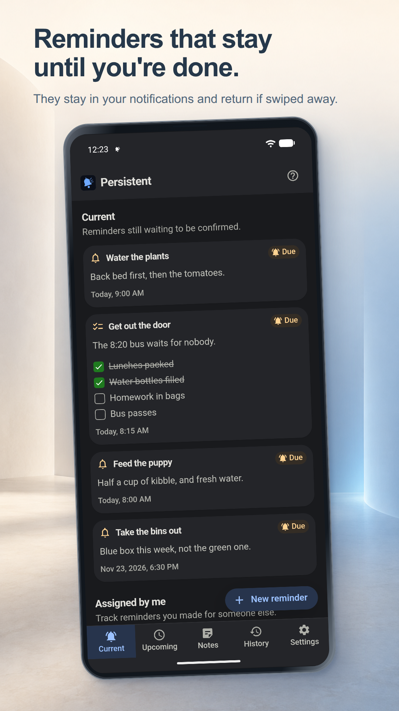
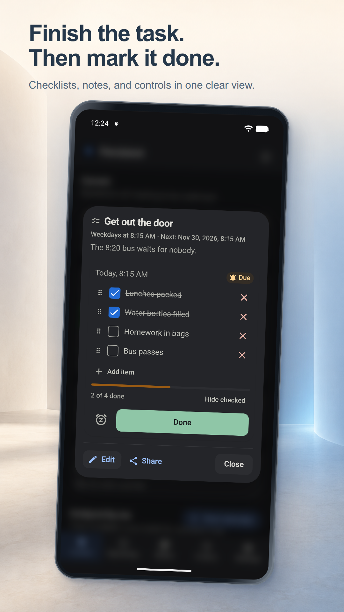
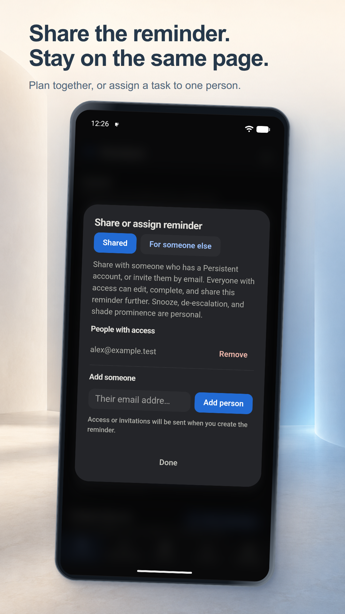

  

<h1 align="center">Persistent</h1>

  Reminders that return until confirmed.

<!-- Official store badges lead with the recommended Android app. -->

  

  
  

  

<!-- These are the same synthetic-data mockups used by the Play listing. -->

  
  
  

Most reminder apps fire once and are easy to swipe away. Persistent keeps coming back, as a notification that returns or an alarm that keeps ringing, until you _actually mark it done_. It is built for the things you cannot afford to miss.

## Features

- **It won't be ignored:** on Android, choose a notification that keeps coming back or a full-screen alarm that rings until you confirm, even on the lock screen.
- **Nothing slips through:** every due time is tracked on its own, so confirming the 1:00 reminder never clears the 9:00 one you missed.
- **Works offline:** the Android app schedules alarms on your phone, so they ring with no signal and with the app closed.
- **Escalation:** an ignored reminder can become a louder alarm on your devices and email a contact you choose.
- **Flexible schedules:** right now, once, or repeating: daily, chosen weekdays, every few days or monthly, including the last day of the month. Custom snooze, your choice of notification and alarm sounds, and a history with **Undo done**.
- **Checklists and notes:** tick items off as you go; a repeating checklist starts fresh each time, and you confirm when the whole task is done.
- **Share or assign:** invite people by email to edit and complete a reminder together, or assign one to someone and see when it was handled. Snoozes stay personal.
- **Medication reminders:** keep a medicine name and dose with a reminder. Persistent helps you remember; it does not provide medical advice.
- **On every device:** Android, Windows, Linux and the web, in sync on one account, in seven languages.
- **Simple sign-in:** an email code, a passkey or Google. No password to forget.
- **Make it yours:** light and dark themes that follow your device, plus color palettes and optional doodle backgrounds.
- **Your data stays yours:** no ads or third-party trackers. The apps collect no telemetry; the web app counts visits with cookieless, self-hosted analytics, and the service keeps only aggregate usage counts. Download or delete your data any time in **Settings > Account**; see the [privacy policy](https://persistent.dynamic-solutions.ca/privacy).

## Get it

### Android

Recommended for alarms that ring offline. Requires Android 7.0 or newer. Install Persistent from [Google Play](https://play.google.com/store/apps/details?id=ca.dynamicsolutions.persistent). During phone and video calls, alarms wait quietly as notifications and resume afterwards.

### Desktop

Persistent for Windows and Linux lives in the tray: one click opens a resizable flyout for viewing, editing, sharing and confirming reminders. Turn on **Persistent notifications on this PC** in Settings to have dismissed reminders return, nags repeat and alarms ring until you act, with Done and Snooze right on the notification.

Desktop alerts run while Persistent is open and your computer is awake. For alarms that ring offline or with the app closed, add the Android app.

#### Windows

**Install:** get Persistent from the [Microsoft Store](https://apps.microsoft.com/detail/9PCX2XGQ7CJS), or download the portable ZIP for your computer (x64 or ARM64) from the [Windows releases](https://github.com/Dynamic-Solutions-Canada/persistent/releases?q=desktop&expanded=true). Unzip and run the portable app; it needs no installation.

**Updates:** the Microsoft Store keeps its build up to date. The portable app checks for new Windows releases and links to the download, which you replace manually.

**Desktop integration:** the Store build also adds an Upcoming widget for Windows 11, with the next two reminders at small size, four compact rows at medium size, or four expanded rows at large size.

#### Linux

**Install:** download an AppImage from the [Linux releases](https://github.com/Dynamic-Solutions-Canada/persistent/releases?q=Linux&expanded=true). It is available for Intel/AMD 64-bit and ARM64 computers.

| Computer            | AppImage filename ends with |
| ------------------- | --------------------------- |
| 64-bit Intel or AMD | `x86_64.AppImage`           |
| ARM64               | `arm64.AppImage`            |

Mark the download executable and run it. Use `--install` to add a user-level application-menu launcher and keep a stable path for updates; no Node toolchain is needed. AppImage is the only supported Linux package format. See [Linux installation details](apps/linux-desktop/README.md#build-package-and-install) for requirements and troubleshooting.

**Updates:** the app can check automatically or manually, then asks separately before downloading and installing. AppImage updates are user-level and preserve the existing installation path. Enable Start at sign-in in Settings for automatic startup when you log into your desktop.

**Desktop integration:** works with KDE Plasma and GNOME (AppIndicator), on X11 and Wayland. See [Persistent for Linux](apps/linux-desktop/README.md) for tray placement and other desktop details.

### Web

Open [persistent.dynamic-solutions.ca](https://persistent.dynamic-solutions.ca) in any browser and sign up free. It installs as a web app, with the same account and live data as every other device. For alerts, add the Android, Windows or Linux app.

## Developers

- [Development](docs/development.md): setup, running, testing and releases.
- [Deployment](docs/deployment.md): the production server, backups, and account data.
- [Architecture](ARCHITECTURE.md): how the server, web app and native hosts fit together.
- [Windows build and packaging](https://github.com/Dynamic-Solutions-Canada/windows-build-tools#readme) and [Linux build and packaging](apps/linux-desktop/README.md).
- [devkit](https://github.com/Dynamic-Solutions-Canada/devkit#readme), the development environment, including remote development.

## License

Licensed under the [PolyForm Noncommercial License 1.0.0](LICENSE). Copyright (c) 2026 Dynamic Solutions. Bundled third-party software stays under its own licences; see [NOTICE](NOTICE).
