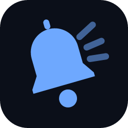
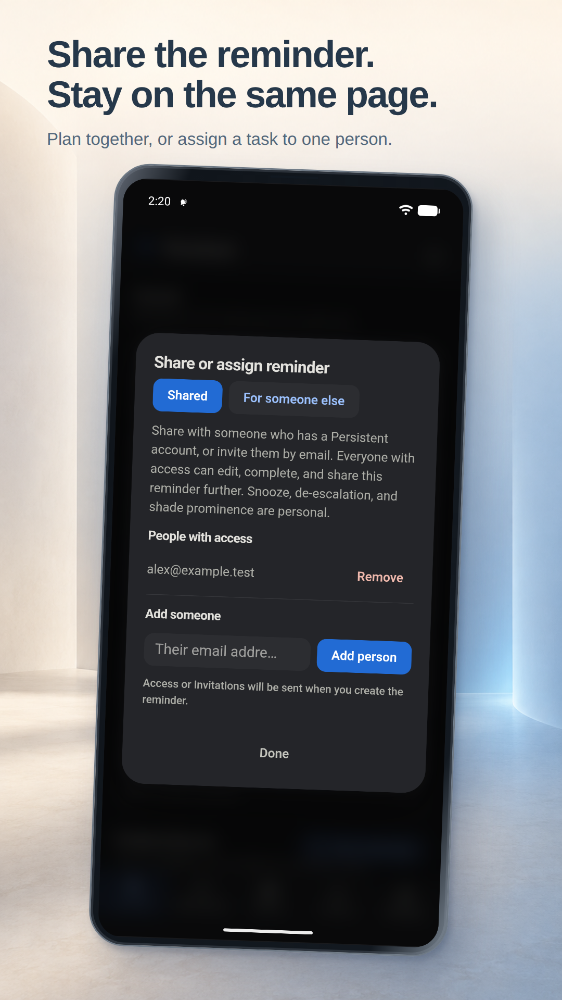

  

<h1 align="center">Persistent</h1>

  Reminders that return until confirmed. Alarms, checklists and shared reminders.

<!-- Official store badges lead with the recommended Android app. -->

  

  
  

  

<!-- These are the same synthetic-data mockups used by the Play listing. -->

  
  
  

Most reminder apps fire once and are easy to swipe away. Persistent keeps nagging, with a notification that won't dismiss or a full alarm that loops, until you _actually mark it done_. It's built for the things you can't afford to miss.

## Features

- **Your language and formats:** English (US/Canada), Spanish (Spain), French (France/Canada), German, Simplified Chinese, Brazilian Portuguese and Japanese. Match the device or choose an interface language in Settings. Date formatting, 12/24-hour display, account time zone and email language remain independent. Reminder text and medication details stay as entered. See [localization](docs/localization.md) for native compatibility and verification limits.
- **It won't be ignored:** on Android, choose a persistent notification that re-sounds, or a full-screen alarm that rings continuously until you confirm, even with the phone locked. Windows and Linux offer persistent alerts while the app runs and your computer is awake.
- **Escalation:** if you still haven't acted, it can escalate to a louder alarm on your devices and email a chosen contact with your covering message and what is actually overdue, so they can act on it. You can silence that alarm without losing the reminder, so it keeps nagging quietly.
- **Nothing slips through:** every firing is tracked on its own. If a reminder has several times of day, each one nags and is confirmed separately, so confirming the 1:00 firing never silently clears the 9:00 one you missed.
- **Works offline:** the Android app schedules exact on-device alarms, so reminders fire even with no signal, and sync across your devices.
- **Flexible:** remind me now with no date to pick; a one-time or repeating schedule (daily, weekdays, every N days, or monthly on the days you choose, including the last day of every month); or never at all, for something you want to keep but never be reminded about. Multi-line notes stay multi-line wherever you read them. Set custom snooze and re-nag intervals, separate tones for a reminder firing and for its follow-up nags (and any single reminder can use its own tones instead of your device's), per-reminder notification-shade prominence (Android), and a history of what you've done. Open a completed entry in History and choose **Undo done** to resume its reminders after an accidental completion. This works for personal and shared reminders of every type.
- **Checklists:** a reminder can cover several things at once, such as a morning routine or a packing list. Tick items off as you go; each firing tracks its own ticks, so a repeating checklist starts fresh every time, and the notification lists only what you have left. Hide the ticked ones to see just what's outstanding; a long list stays collapsed the way you left it, on every device you use. Ticking everything still doesn't confirm it; only you do. Reminder cards open a reading dialog: click a title or note body to edit its text, or add, reorder, rename, and remove checklist items there. A typed, nonempty new item saves when you leave its field or close the reading dialog. Edit opens the full form when you need it; new rows there are included on Save.
- **Share a reminder:** invite someone by email, including someone who has not signed up yet. Everyone with access can edit it and mark a firing done for the group. Snoozes and alarm escalation are personal, so one person's snooze does not silence another person's alert. Reminders shared with you appear in Current, Upcoming, Notes, and History as appropriate; Settings has a full Shared with me list. The usual reading view supports checklist ticks, Done, Snooze, and de-escalation. Share lists the owner and members, lets any member invite someone else, and offers Leave to recipients. The owner and the person who invited someone can remove their access. Android shade prominence is personal.
- **Edit together safely:** shared notes and checklists refresh live. Different checklist items can be edited independently; conflicting text or full-editor saves show an error and keep the draft in the open editor for review.
- **Assign a reminder:** create one for a single other person. They own its alerts and actions; you can see when each firing was handled in Assigned by me. They can decline it.
- **Medication reminders:** keep a medicine name and dose with a reminder. Persistent helps you remember; it does not provide medical advice.
- **Simple sign-in:** a one-time email code, a passkey, or Sign in with Google. There is no password to forget or leak.
- **Your data stays yours:** no ads or third-party trackers; the apps collect no telemetry or crash reports, and the web app counts visits with cookieless, self-hosted analytics. Administrators can view aggregate service activity and feature usage counts from the service's own database. Download a copy of your data, or delete your account and everything in it, from **Settings > Account** at any time; see the [privacy policy](https://persistent.dynamic-solutions.ca/privacy).

## Get it

### Android

Recommended for alarms that can sound offline. Requires Android 7.0 (API 24) or newer, the oldest version Google Play's automatic protection supports. Install Persistent from [Google Play](https://play.google.com/store/apps/details?id=ca.dynamicsolutions.persistent). The app can sound previously scheduled alarms even while offline. During detected phone or voice/video calls, alarms wait quietly as notifications and resume after the call if you have not handled them.

### Desktop

Persistent is available for Windows and Linux, with installation details for each below. Sign-in uses a regular window with native controls. After sign-in, both keep the same reminder interface in a tall, resizable tray flyout for viewing, editing, sharing and confirming reminders. You can enable **Persistent notifications on this PC** in Settings; notifications are off by default on both platforms. Once enabled, the app restores dismissed reminders, repeats configured nags and loops alarm audio for Alarm reminders and escalations. Notifications offer Done, Snooze and De-escalate where applicable. On Linux, Snooze opens the app's full picker; Windows offers a notification dropdown.

These alerts work while the app runs and the computer is awake. Both apps catch up after reconnecting, but cannot alert you while closed or while the computer is asleep. Use Android for previously scheduled alarms that must sound offline.

#### Windows

**Install:** get Persistent from the [Microsoft Store](https://apps.microsoft.com/detail/9PCX2XGQ7CJS), or download the portable ZIP for your computer (x64 or ARM64) from the [Windows releases](https://github.com/Dynamic-Solutions-Canada/persistent/releases?q=desktop&expanded=true). Unzip and run the portable app; it needs no installation.

**Updates:** the Microsoft Store keeps its build up to date. The portable app checks for new Windows releases and links to the download, which you replace manually.

**Desktop integration:** the Store build also provides a Windows 11 widget with the next two reminders at small size, four compact rows at medium size, or four expanded rows at large size.

#### Linux

**Install:** download an AppImage from the [Linux releases](https://github.com/Dynamic-Solutions-Canada/persistent/releases?q=Linux&expanded=true). It is available for Intel/AMD 64-bit and ARM64 computers.

| Computer            | AppImage filename ends with |
| ------------------- | --------------------------- |
| 64-bit Intel or AMD | `x86_64.AppImage`           |
| ARM64               | `arm64.AppImage`            |

Mark the download executable and run it. Use `--install` to add a user-level application-menu launcher and keep a stable path for updates; no Node toolchain is needed. AppImage is the only supported Linux package format. See [Linux installation details](apps/linux-desktop/README.md#build-package-and-install) for requirements and troubleshooting.

**Updates:** the app can check automatically or manually, then asks separately before downloading and installing. AppImage updates are user-level and preserve the existing installation path. Enable Start at sign-in in Settings for automatic startup when you log into your desktop.

**Desktop integration:** targets KDE Plasma and GNOME with AppIndicator support, on X11 and Wayland. GNOME may require double click to open the flyout. The default follows Electron's native backend. KDE Wayland uses a process-scoped KWin helper for tray-corner placement; other Wayland compositors choose placement. Tray and notification presentation vary by desktop.

### Web

Open [persistent.dynamic-solutions.ca](https://persistent.dynamic-solutions.ca) in any browser and sign up free. It installs as a web app for managing reminders, with the same account and live data as every other surface. Browser notifications are not supported; install a native app to be alerted.

## Appearance and settings

Choose your appearance in **Settings > Theme**: **Match system** is the default and automatically switches between Enjoy Light and Enjoy Dark with your device. Choose either Enjoy theme to keep one appearance. Classic Light and Classic Dark retain the previous styling, and Forest and Plum offer colored palettes. Each palette recolors the whole app, including cards and dialogs. Navy keeps the original dark blue surfaces and teal accents. The Enjoy themes use warm gray surfaces, blue accents, rounded headings and controls, quiet surfaces, and soft shadows inspired by [Enjoy's app](https://enjoy.dev). Native alarm screens inherit their colors; their fonts and shapes follow the platform.

Doodles are enabled by default. The **Doodle background** dropdown offers Match theme, No doodles, and doodle line colors from pale shades for Light or dark shades for the darker themes; choose No doodles for a plain appearance without changing your saved palette. The page background follows your theme, and your choices are saved on each device. Existing Navy settings and retired Navy variants switch to Match system once, keeping their doodle preferences; you can select Navy again afterward.

**Settings > Account** brings your account details, passkeys, sign-out, and permanent deletion together. **Settings > Apps > Our other apps** lists our other products with platform labels and links, including Windows apps.

## Developers

- [Development](docs/development.md): setup, running, testing and releases.
- [Deployment](docs/deployment.md): the production server, backups, and account data.
- [Architecture](ARCHITECTURE.md): how the server, web app and native hosts fit together.
- [Windows build and packaging](https://github.com/Dynamic-Solutions-Canada/windows-build-tools#readme) and [Linux build and packaging](apps/linux-desktop/README.md).
- [devkit](https://github.com/Dynamic-Solutions-Canada/devkit#readme), the development environment, including remote development.

## License

Licensed under the [PolyForm Noncommercial License 1.0.0](LICENSE). Copyright (c) 2026 Dynamic Solutions. Bundled third-party software stays under its own licences; see [NOTICE](NOTICE).
