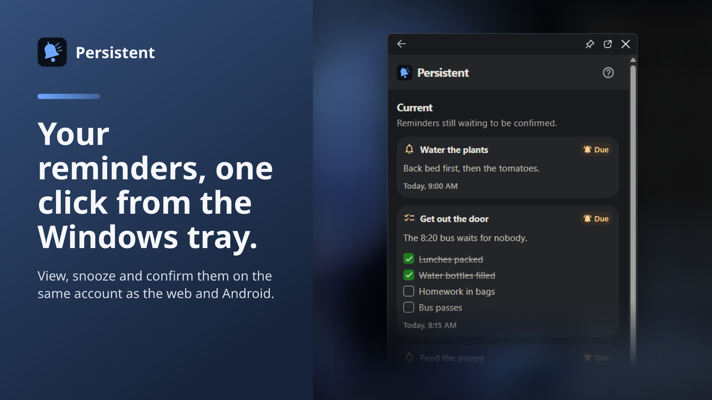
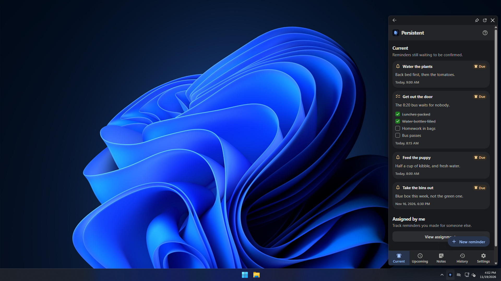
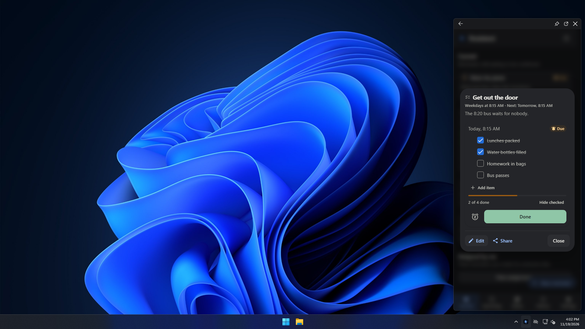
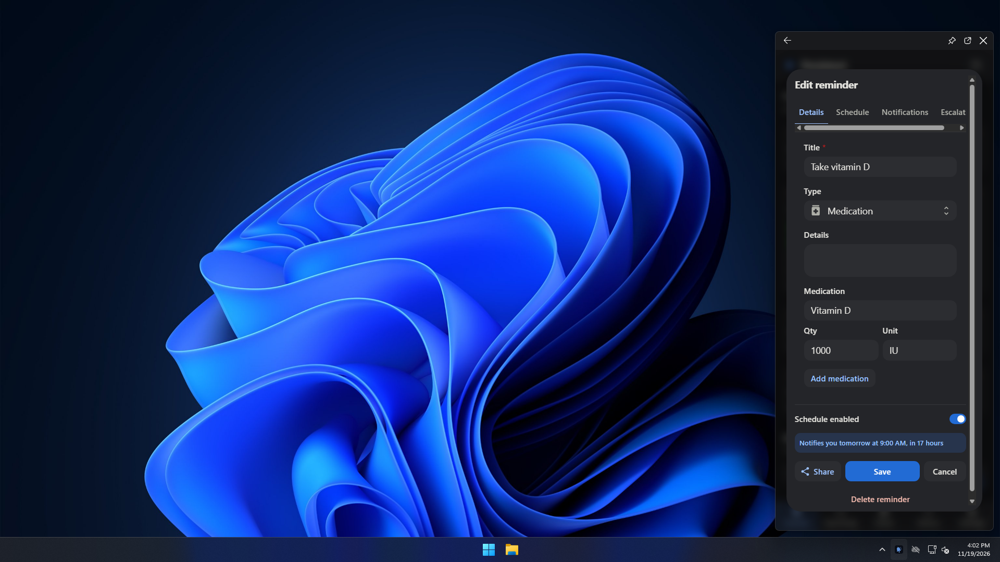
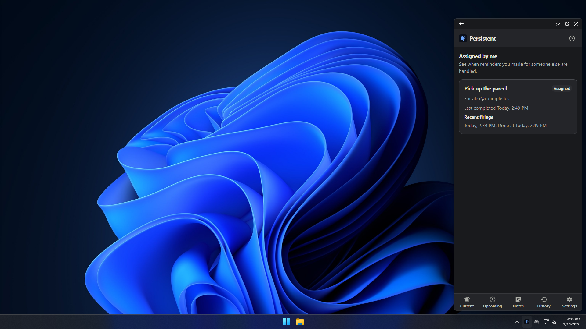

# Microsoft Store screenshot review

A generated first screenshot in each listing locale, then four Windows tray-flyout captures from the Windows 11 test VM, November 19, 2026, rendered from `../raw/microsoft/` by winui-app-kit's renderer. The default 420 x 960 flyout sits above the real Windows taskbar on the dark default wallpaper, with nothing composited. App data is synthetic. Uploading is a separate step.

## Generated hero (first in every listing)

Drawn by devkit-store-hero from the Current capture (`../README.md`, Hero). English shown; the other locales are in `screenshots/<locale>/`.

## Current, Enjoy Dark

## Checklist, Enjoy Dark

## Medication, Enjoy Dark

## Assigned by me, Enjoy Dark

